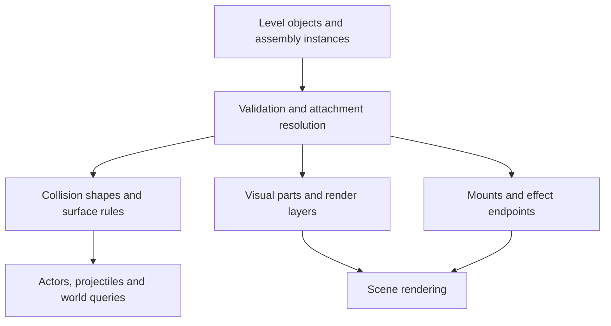

# Flexible world geometry and construction

Research and proposal, 9 November 2026. This document describes a replacement for the fixed 48-pixel authoring pipeline. It does not change runtime behavior or establish new movement, water or story mechanics.

**Implementation status:** the free-rectangle foundation, concrete structure classes, independent surfaces, shared collision service, socket mounts and workshop integration are now implemented. See [world structures](world-structures.md) for the actual API and supported scope. Later one-way/polygon/slope stages below remain proposals.

## Recommendation

Use a hybrid scene format: freely placed objects and explicit collision shapes, reusable construction assemblies, optional visual tile layers, and independent render layers. Keep a grid as an editing aid. A material's texture repeat size must never dictate a platform's thickness, position or collision shape.

For example, a bridge can be 317 pixels wide with a 14-pixel-thick deck, at any pixel position. Its sprite caps remain at native proportions, its middle repeats and crops to fit, its deck supplies collision, and its arches and railings supply decoration. A foreground railing can draw over the player without blocking them. A background wall can look substantial while remaining outside the playable plane.

## What the current code actually limits

The existing rectangle collision math already accepts arbitrary rectangle bounds; it has no intrinsic 48-pixel cell requirement. The restriction is introduced by the surrounding pipeline:

| Owner | Current assumption | Replacement responsibility |
| --- | --- | --- |
| `LevelDocument.ts` / `LevelValidation.ts` | Schema v1 fixes tile size and aligns terrain and dimensions to 48 | Schema v2 stores independent shapes, placements and optional editing settings |
| `LevelCompiler.ts` | Expands authored terrain rectangles into individual tiles | Compile authored shapes directly into physics geometry; compile artwork separately |
| `EditorCanvas.ts` | Creation, dragging, grid drawing and actor placement use 48 | Configurable snap, precise dimensions, guides and a free-placement mode |
| `ConfluenceTerrainRenderer.ts` / `WallRenderer.ts` | Physical solids imply tile drawing and neighbor checks | Render visual surfaces and their exposed boundaries independently of collider tessellation |
| `RebuiltConfluenceAssemblies.ts` / older structures renderer | Reconstruct floors from 48-square collision tiles | Consume explicit construction definitions and resolved attachment points |
| `ConfluenceObjectsRenderer.ts` | Rebuild object art snaps bottoms upward to a 48-pixel line | Place artwork using declared origins and mount/floor anchors |
| Player, enemies, NPCs, visibility and projectile queries | Share rectangle lists | Preserve consistent query behavior, then extend all consumers when adding new shape types |

This is broader than changing a tile-size constant. Removing the validator restriction alone would let us author geometry that parts of the renderer silently skip.

## Research findings

Tiled provides free object placement, rectangle/polygon collision objects, and graphical objects independently of tile layers. Its templates support reusable object definitions with instance overrides. These are useful precedents for our own format, rather than a requirement to replace our editor. [Objects](https://doc.mapeditor.org/en/stable/manual/objects/), [templates](https://doc.mapeditor.org/en/stable/manual/using-templates/).

Tiled also supports image collections with different image sizes and separately authored collision shapes and attachment information. This supports retaining our existing art at its useful native dimensions. [Tilesets and collision editor](https://doc.mapeditor.org/en/stable/manual/editing-tilesets/).

LDtk separates integer-grid, tile and entity layers; entities can use grid or free placement. This is a good model for keeping tile painting useful without imposing it on every structure. [Layers](https://ldtk.io/docs/general/editor-components/layers/).

Godot's nine-patch rendering preserves corners and repeats the middle and edges. The same rendering technique is useful for rectangular masonry and frames in our Canvas renderer. Seamless textures are still required; nine-slicing does not manufacture missing art or solve arbitrary polygon junctions. [NinePatchRect](https://docs.godotengine.org/en/stable/classes/class_ninepatchrect.html).

Box2D documents unwanted collisions at internal connections between neighboring shapes, and explains how connected edge information can eliminate those contacts. Fewer rectangles can reduce our seam count, but arbitrary shapes will still need deliberate handling of exposed boundaries and adjacency. [Ghost collisions](https://box2d.org/posts/2020/06/ghost-collisions/).

Godot documents one-way surfaces separately from polygon shape, while its character controller exposes floor angle, slope stopping and snapping. These illustrate why new shapes alone do not deliver good slope or platform behavior. We must define and test character movement semantics as well. [CollisionPolygon2D](https://docs.godotengine.org/en/stable/classes/class_collisionpolygon2d.html), [CharacterBody2D](https://docs.godotengine.org/en/stable/classes/class_characterbody2d.html).

The architecture below is our project-specific recommendation based on these patterns. Adopting Godot or Box2D is not part of the proposal.

## The proposed model

### 1. World coordinates and editing grids

Use world pixels for placements and dimensions. Whole-pixel authoring is sufficient initially; simulation continues using floating-point positions. Offer snap presets such as 1, 4, 8, 16 and 48 pixels, plus free placement and edge/socket snapping. Grid settings belong to the editor, separate from image cell sizes and physics.

Keep native pixel density consistent. Integer placements and camera rendering can keep artwork crisp without quantizing physical motion. A 48-pixel texture is still useful; it simply repeats or clips inside a larger or smaller visual region.

### 2. Explicit shapes and surface behavior

Start with axis-aligned rectangles of arbitrary dimensions and compound objects made from multiple rectangles. A hollow doorway consists of two jambs and a lintel; its opening stays empty. An illustrated arch can use a few authored collision pieces instead of tracing every stone.

Design the collision API to grow into convex polygons and connected static terrain boundaries. Concave filled shapes require decomposition or another supported representation; holes require explicit empty space. Reject unsupported shapes during authoring and loading rather than silently reducing them to bounding boxes.

Collision behavior is separate from appearance and material:

| Behavior | Meaning |
| --- | --- |
| Solid | Blocks the selected actor/projectile query groups |
| One-way surface | Supports permitted downward crossings from above; side and underside rules are explicit |
| Sensor region | Detects overlap without providing physical support |
| Visual-only object | Has no collider |

Collision categories and query masks must be independent of draw order. Define projectile and sight behavior explicitly, especially for grates, sensors and future one-way platforms. Visual materials may select art, sound and effects; they must not silently introduce friction, damage or resource effects.

### 3. Construction assemblies

A reusable assembly is a data definition that produces independent visual parts, collision parts and named attachment points. The editor places and manipulates the assembly as one object; rendering and physics consume their own compiled outputs.

Examples: bridge span, station shelter, retaining wall, pipe run, doorway and mounted outfall. Each declares an origin, permitted dimensions, collision profile, repeat/stretch rules and sockets. A bridge might expose `deckStart`, `deckEnd` and `supportMount`; an outlet might expose `inlet` and `mouth`.

Illustrative authored placement, **not an implemented schema**:

```json
{
  "id": "freight-bridge-west",
  "assembly": "confluence/bridge-span-v1",
  "position": {"x": 137, "y": 622},
  "parameters": {"width": 317, "deckThickness": 14},
  "collisionProfile": "solid",
  "material": "confluence/dark-steel"
}
```

The assembly builder generates the 317-by-14 deck collider in local coordinates and visual deck sections from the same parameters. Decorative overhang can extend beyond it. It does not create an enclosing collider around the entire bridge image.

Keep stable instance IDs and derive stable child IDs. Allow deliberate instance overrides, and pin assembly definition versions so changing a library asset cannot unexpectedly rewrite every level. Begin with translation and explicitly supported mirroring/parameterized resizing. Arbitrary rotation of a rectangle creates a different collision problem and must be validated against the supported shape set.

### 4. Visual surfaces and layers

Support three complementary visual tools:

- Sprites for unique landmarks, windows, props and authored corners.
- Repeated/clipped surface materials with intact end caps for adjustable walls, beams and platforms.
- Optional tile painting for areas where a tile brush is convenient.

Rendering follows explicit layers such as distant scenery, rear architecture, terrain surfaces, actors and foreground details. A single assembly may contribute to several layers. A foreground trim piece does not acquire collision because of its layer, and a rear wall is not automatically solid.

For adjacent filled regions, derive visible boundaries from the shared construction geometry. Suppress internal trims and expose real corners, ceilings, openings and wall/deck joints. An L-shaped wall needs junction rules beyond drawing two independent nine-slice rectangles over one another.

### 5. Structural and water connections

Use local attachment references instead of disconnected absolute coordinate lists. A wall-mounted clock references a bracket socket; a downpipe references a gutter outlet; a fall references its mouth and receiving-water surface. Moving the owning structure updates these connections.

Validate missing mounts, incompatible sockets, overlaps at playable openings and unsupported resizing. Show warnings for apparently unsupported architecture and disconnected water paths, with intentional exceptions for background ruins or hanging structures. These checks should aid design, not enforce a real-world structural simulation.

Water paths and electrical conduits can be visual polylines with fitted corner pieces. Their visual curves do not become collision shapes automatically. Keep swimming, hazards, moving water and other unresolved mechanics outside this geometry change.

## Runtime boundaries



Proposed concern-separated modules:

| Module | Owns |
| --- | --- |
| Versioned level document / validation | Authored objects, references, supported shape types and migration |
| Assembly catalog / builder | Parameterized local construction and stable child identities |
| Attachment resolver | World transforms and socket references; reject reference cycles |
| Collision world | Shape storage, filters, sweeps, overlap/raycast/support queries |
| Character controller | Ground/wall/ceiling interpretation and existing movement feel |
| Surface renderer | Repetition, clipping, exposed borders and junction art |
| Scene renderer | Layer order, culling and visual composition |
| Editor tools | Placement, dimension handles, snapping, overlays and connections |

Retain the custom fixed-step character controller for the initial rectangle transition. Introduce a shared collision-query interface before adding polygons, so enemy ledge probes, NPC floor checks, projectile sweeps, ghost materialization and visibility checks cannot disagree about geometry. Use a spatial index if profiling warrants it; its internal cells never constrain authored shapes.

## Concrete TypeScript structure

The current `Wall` class is effectively a positioned rectangle, and `Map` wraps both collision and decoration rectangles in it. Replace that ambiguous role with explicit definitions and focused runtime services. Keep each construction type in its own file, as with the enemy roster.

Suggested ownership and names (proposed, not implemented):

```text
src/world/
  structures/
    StructureDefinition.ts
    StructureBuilder.ts
    StructureCatalog.ts
    Bridge.ts
    WallSection.ts
    Platform.ts
    Doorway.ts
    Outfall.ts
  scene/
    SceneObject.ts
    AttachmentResolver.ts
  collision/
    ColliderDefinition.ts
    ColliderHandle.ts
    CollisionWorld.ts
    CollisionQueries.ts
  surfaces/
    SurfaceDefinition.ts
    SurfaceRenderer.ts
```

`Bridge`, `WallSection`, `Platform`, `Doorway` and `Outfall` are construction builders sharing a small interface. Each validates its supported parameters and creates local visual parts, collider definitions and sockets. A builder does not load images, draw to Canvas, resolve physics or receive a per-frame update. `StructureCatalog` maps validated type IDs to builders; the level compiler resolves definitions into placed scene objects and independent physics/render outputs.

`SceneObject` owns instance identity, placement, child references and collider handles. Collision geometry, visual bounds and editor selection bounds remain distinct. If placement changes, the owning scene operation resolves transforms and refreshes the affected collision and visual outputs together. Nested ownership is deliberately bounded; it is not a general-purpose scene engine.

`ColliderDefinition` is a discriminated data union, initially with rectangle shape support. Surface behavior and query filters are separate fields. `ColliderHandle` identifies a registered runtime collider so it can be enabled, disabled or removed without searching/mutating an anonymous `solids` array. `CollisionWorld` owns registration and geometry queries; `CollisionQueries` provides the narrow interface consumed by actors, projectiles and visibility. Callers depend on the queries they need, not Canvas classes or structure subclasses.

`SurfaceDefinition`, points, rectangles and socket records should stay serializable data. `SurfaceRenderer` owns clipping, repetition and border drawing using validated asset metadata. Image loading remains with the asset loader. Classes are appropriate for construction logic, state, lifecycle and services; an interface or plain record is enough for inert data.

A `Doorway` builder defines the frame and opening. A separately owned gate controller changes its blocker handles and publishes state for the visuals. The existing narrative layer requests operation; it does not manipulate collider internals. A static bridge needs no runtime behavior object ticking at 120 Hz. Future genuinely moving platforms would add a movement controller when that feature is designed.

Avoid an inheritance tree such as `GameElement -> Wall -> Platform -> Bridge`, or `SolidWall`/`NonSolidWall` subclasses. A bridge is a compound construction, and solidity belongs to its individual collision parts. Background wall art can reuse the same surface material without inheriting physical behavior. Share surface-generation helpers and local-shape builders instead of forcing every construction through a large base class.

This makes additions concrete: a new bridge style can reuse the `Bridge` builder with different skin data; a construction with different geometry gets its own builder; a new gameplay behavior gets a focused controller. Neither needs a new condition in `World.update()` or a universal object class with dozens of flags.

## Migration and proof

1. **Free rectangle foundation:** schema v2, direct rectangle compilation, arbitrary dimensions, selectable snap, independent surface rendering, and v1 import. A thin ledge and a non-grid wall must both be editable, visible and physically correct. Keep existing collision tolerances and movement tuning.
2. **Reusable construction:** bridge/wall/shelter assemblies, local coordinates, explicit layers and attachment sockets. Move complete structures with their props and collision. Convert a small arrival/viaduct section and compare it with the current build before converting the district.
3. **Surface behavior:** one-way surfaces and sensor regions, with explicit masks and crossing semantics. Passing through from below, landing at speed, leaving edges and interacting with projectiles need dedicated checks. Drop-through input remains a separate control decision.
4. **Shaped terrain:** slopes and convex static pieces, continuous shape queries and seam-aware boundaries. Define maximum walkable angles, downhill contact/snap, ceiling behavior, wall-jump classification and bullet collision. Curved decorative arches can already exist before this stage; genuinely curved walkable terrain is a later capability.

V1 import should preserve the original authored terrain rectangles rather than expanding them to tiles. Preserve actor anchor conventions, story IDs, save behavior, editor undo/redo, CLI patches, revision checks and validation atomicity. Provide a shared normalized authoring representation for the editor so opening and saving a v1 map does not lose content. Exporting v2 into v1 must reject unsupported content rather than silently rounding it.

Keep active interactive blockers owned by their source objects. Opening a shutter must update collision queries and any spatial index without stale cached geometry. Keep IDs and exposed visual surfaces independent of optimized physics rectangles: merging adjacent blockers must not erase a gate's identity or prevent its removal.

The proof scene should contain a 317-by-14 bridge at an odd coordinate; a hollow arch; adjoining L-shaped walls; a background facade and foreground railing; a mounted clock; and a gutter/outlet/basin connection. Check walking, running, sprinting, crouching, jumps, wall movement, enemy floor detection, projectiles and sight against the same geometry. Move and resize assemblies in the editor and confirm attachments follow. When slope/one-way stages arrive, extend this scene with their edge cases.

## Decision

Proceed with free rectangles and reusable assemblies as the first implementation. This removes the practical 48-pixel limitation using the physics we already have and addresses the visual alignment problems at their source. The model leaves a deliberate path to polygons and surface-specific behavior, without claiming those capabilities exist before their collision and editor work is complete.
