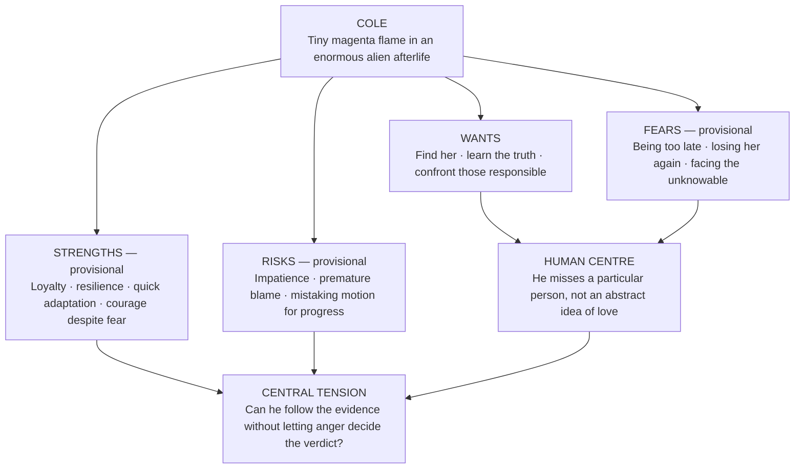

# UNDERWORLD — COLE
## Provisional Character Diagram · v0.1

**Status:** Working character bible. **Cole** is the chosen name. Everything marked *Interpretation* or *Possibility* remains open to revision.  
**Setting:** *Underworld* — a cyberundead, level-based action-platformer.  
**Character function:** Playable protagonist, outsider, investigator, and increasingly dangerous person in search of his girlfriend.

> **Character north star:** A small, frightened, fiercely loving person who turns uncertainty into motion. His tenderness gives the journey purpose; his anger could compromise it.

---

## 1. At a glance

| Dimension | Current understanding | Status |
| --- | --- | --- |
| Name | **Cole** | **Chosen** |
| Nature | A cyberundead traveller, newly arrived in the underworld | **Established premise** |
| Immediate aim | Find his girlfriend and learn what happened to her | **Established premise** |
| Retributive impulse | Wants to punish whoever is responsible | **Established premise** — responsibility itself is not established |
| Face | Compact near-black/void-like face, bright pink-magenta eyes, pale skeletal framing; **not** a conventional full exposed skull | **Existing visual direction** from dialogue/game sprites; inspect exact art before final art approvals |
| Silhouette | Lean exposed bones, fitted dark clothing, burgundy scarf/short ragged cloak, buckled boots, connected magenta head-flame, small cyan equipment/vial detail | **Existing visual direction** |
| Soul-flame at boots | Brief magenta ignition at push-off during sprint, rather than literal rocket thrusters | **Proposed visual effect** |
| Voice | Dry, impatient, capable of warmth and unexpectedly quiet vulnerability | **Interpretation** |
| Inner fear | He may be too late; the relationship and the world may have changed | **Interpretation**, not yet established backstory |

## 2. The diagram

**Structural reading:** His goal supplies direction, fear supplies urgency, anger supplies momentum, and care is the reason the journey matters. The danger is that urgency may begin to masquerade as certainty.

## 3. Outside / inside

| What others may see | What may be happening underneath |
| --- | --- |
| A sarcastic, impatient little skeleton demanding answers | Someone afraid that every delay matters |
| A reckless fighter who refuses to stop moving | Someone who struggles with stillness because it leaves room for dread |
| A surprisingly dangerous cyberundead stranger | Someone vulnerable to tenderness and ordinary kindness |
| A person who wants a culprit | Someone who wants reassurance that his search can change something |
| A traveller who keeps looking forward | Someone repeatedly reminded of the person beside whom he once stood |

These are **interpretive pairings**, not fixed psychological diagnoses. Cole should be allowed to contradict them as we write him.

## 4. The four emotional engines

### Love — the direction
He is not seeking a trophy or a symbolic soulmate. He is trying to find **his girlfriend, an independent person** with a history, desires, and choices of her own. Her identity and their relationship dynamics are still undecided. His longing is most convincing in small, involuntary moments: turning to share a joke, noticing an empty place beside him, holding back a question he cannot answer.

### Fear — the pressure
*Possibility:* Beneath the rush, he is frightened by his changed body, the unfamiliar world, and the uncertainty surrounding her. This does not prevent courage; it may explain some of his courage.

### Anger — the acceleration
He wants someone held accountable. That urgency makes him active, funny, formidable, and sometimes rash. But a transfer record is not proof of abduction; an obstruction is not automatically evidence of malice. His anger becomes dramatically valuable when it has to coexist with genuine investigation.

### Curiosity and humour — the oxygen
He should still be capable of delight, sarcasm, wonder, irritation at railway bureaucracy, and kindness toward strangers. If all he does is grieve and threaten, he stops feeling like a whole person. The underworld must be able to surprise him.

## 5. How to show him without telling us

| Situation | Possible visible response | What the player reads |
| --- | --- | --- |
| New station, no immediate danger | Looks upward; flame steadies; a small pause before moving | Disorientation plus curiosity |
| Unhelpful bureaucracy | Foot tap, arms folded, sharp one-liner | Impatience without instant cruelty |
| He spots an apparent clue | Sudden alert posture; starts moving before speaking | Hope interrupts everything |
| Someone mentions her | Head-flame momentarily contracts; he answers more quietly | Feeling beneath bravado |
| Sprinting | Scarf trails; tiny sole-flames flare on push-off | Speed is part of his silhouette (effect proposed) |
| He is about to act on uncertain blame | Tight stance, hotter flame, moment of hesitation | His conviction is being tested |
| Someone treats him kindly | Slight awkwardness; offers help in return | He is not defined solely by vengeance |

**Art boundary:** His dialogue face is the compact dark/void-like facial design framed by pale bone, not the large white skull used in some provisional artwork. The live sprites and expression atlas remain the authority for precise pixel details. Avoid changing his clothing, flame silhouette, or facial proportions just to make an illustration more conventionally skeletal.

## 6. Voice (exploratory; not canonical dialogue)

- **Everyday:** “Is there a quicker way to get there?”
- **Dry humour:** “You have a queue for the deceased? Of course you do.”
- **Care:** “Are you all right? No, I mean it.”
- **When pressed:** “I don't need a story. I need to know where she went.”
- **Alone:** “Where are you?”

His voice should have range: he can be brief, funny, courteous, fierce, and suddenly soft. No single quip should become a compulsory catchphrase.

## 7. Possible character trajectory — not a decided arc

1. **Arrival:** Disoriented and determined; he needs a lead.
2. **Momentum:** His abilities, stubbornness, and growing knowledge make him increasingly capable.
3. **Complication:** He encounters people whose motives do not fit his initial assumptions.
4. **Choice:** He may have to decide what justice means when the evidence and his anger diverge.
5. **Encounter:** Finding his girlfriend must be a meeting between two people, not merely completing a rescue objective.

This is a *testable trajectory*, not a mandated redemption narrative. Cole might change little, change profoundly, or discover that his initial assumptions were largely correct. We should let events earn the interpretation.

## 8. Open character questions

- Was **Cole** his name before arriving, or did he take it here?
- What does he remember of his former life and the relationship?
- What first brought him to suspect someone was responsible?
- What does he think happened, and what evidence does he actually possess?
- How does he experience his cyberundead body and its spectral flame?
- Where is his line between force, intimidation, punishment, and cruelty?
- What can make him stop moving, even briefly?
- What kind of person is his girlfriend, what does **she** want, and what agency does she have in the events?
- Which of his traits are present at the start, and which does the underworld draw out?

---

### One-sentence anchor

**Cole is a small cyberundead traveller whose fear makes him hurry, whose love gives him a direction, and whose anger could become either the strength that carries him through the underworld or the force that leads him astray.**
